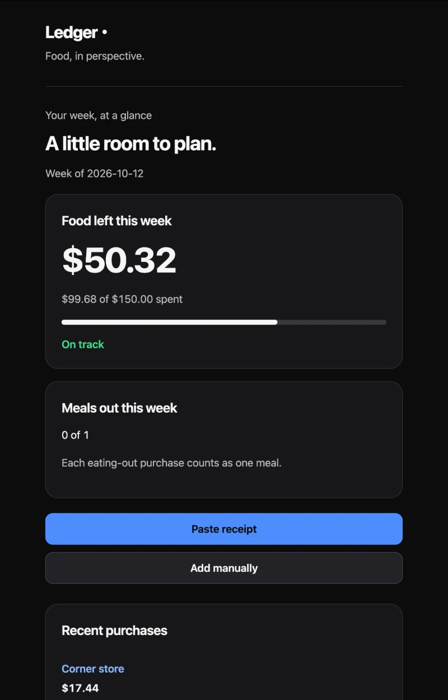
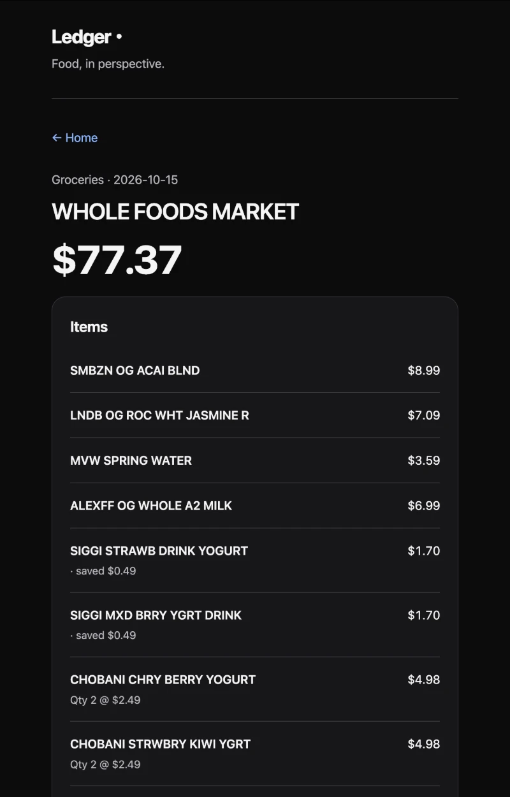
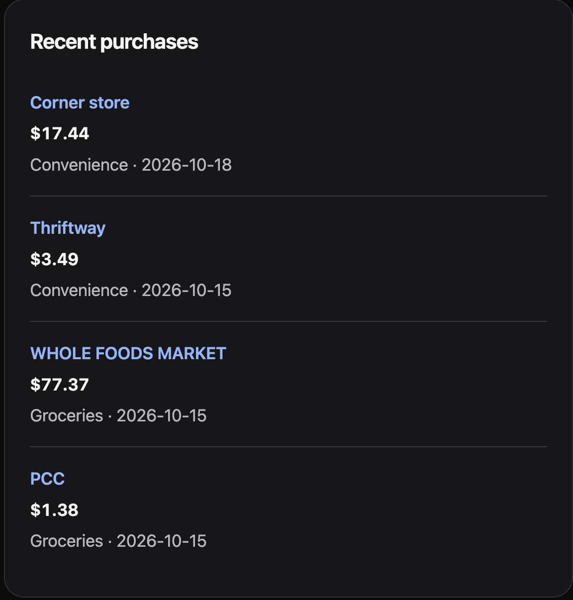
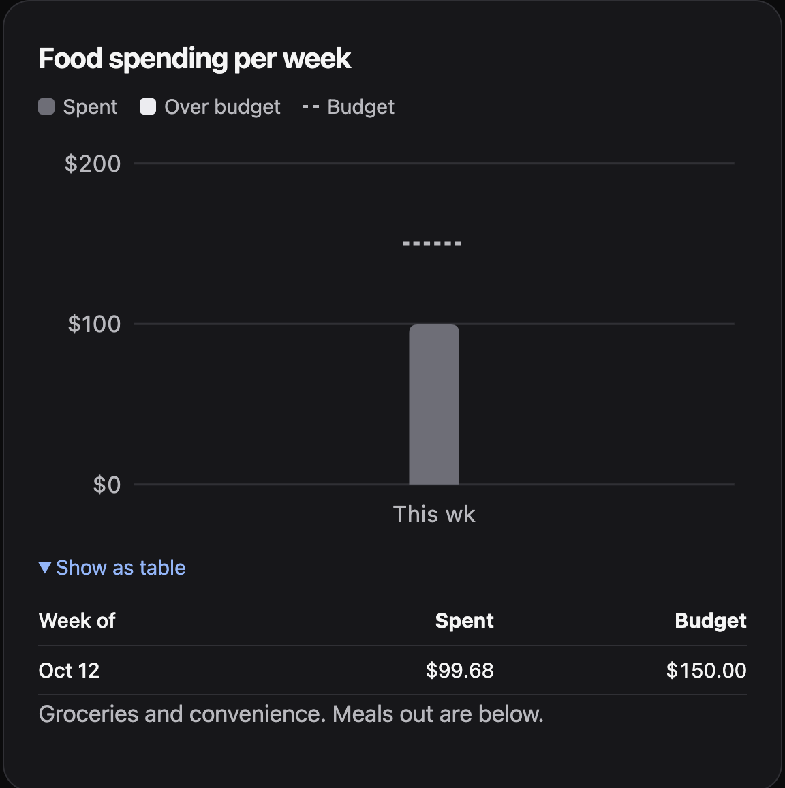

# Ledger

**Know where your food money goes, week by week.** Ledger is a web app for tracking grocery spending against a weekly budget and keeping count of meals out. Log a purchase in a few taps, or paste the text of a receipt and review every item before it's saved.

<p align="center">
  
  
</p>
<p align="center">
  
  
</p>

## Features

- **Weekly budget at a glance.** Home shows what's left of this week's grocery budget, a progress bar, whether you're on track for the day of the week, and meals out against your limit.
- **Quick manual entry.** Amount, store, type and date, with store autocomplete and **Repeat last** for regular purchases. Items are optional.
- **Paste a receipt.** Copy receipt text from a photo (iPhone Live Text or Google Lens) and paste it. Ledger pulls out the store, items, quantities, savings, tax and total, checks that the items add up, and lets you fix anything before saving.
- **Edit and delete** any saved purchase, with its items.
- **Weekly history.** Charts of spending and meals out per week, each compared with the budget you had *that* week, plus a weekly average and how many weeks you stayed within budget.
- **Your settings.** Weekly budget, meals-out limit and timezone. Weeks run Monday to Sunday in your own timezone.
- **Sign in your way.** Email and password, or a one-time email link.

## Tech stack

- [Next.js](https://nextjs.org) (App Router, Server Actions) with strict TypeScript
- [Supabase](https://supabase.com): Postgres, Auth and row-level security
- [Zod](https://zod.dev) for validation, [Tailwind CSS](https://tailwindcss.com) for styling
- [Vitest](https://vitest.dev) for unit tests, plus a PostgreSQL test runner for the database
- Deployed on [Vercel](https://vercel.com)

No ORM, no separate API server, no analytics or tracking scripts.

## Engineering highlights

- **Receipt text stays private.** The parser runs entirely in the browser. Raw receipt text is never sent to a server or stored, and lines that look like card numbers, payment details or phone numbers are dropped before anything else happens. Only the values you review are saved.
- **Saves are safe to retry.** Each purchase and its items are saved in a single database transaction, and every form carries a request ID. If the connection drops and you press Save again, you get the original purchase back, not a duplicate, even when two saves arrive at the same moment.
- **The database checks everything.** Postgres validates every purchase itself (types, money limits, dates, item counts) and computes the receipt math check, so a bad or hand-crafted request can't store invalid data, even one that skips the app.
- **Users can only ever see their own data.** Postgres row-level security restricts every table to its owner. Items inherit ownership from their purchase, and budget history is read-only and written by a database trigger. The app uses only the public key; no service-role key exists in the code.
- **Locked-down pages.** A strict Content Security Policy with a fresh nonce on every request (no inline scripts, no `eval`), no-store caching for personal pages, and auth redirects that never trust the request's Host header.
- **Money is exact.** Amounts are handled as integer cents end to end, never floating-point dollars.
- **Accessible.** Labelled form fields, visible keyboard focus, a skip link, and charts that can also be read as tables.

## Running locally

Requires Node 24 and a Supabase project.

```sh
nvm use
npm ci
cp .env.example .env.local   # add your Supabase URL and anon key
npm run dev
```

Full Supabase and Vercel setup, including the database migrations and auth settings, is in [docs/SETUP.md](docs/SETUP.md).

## Testing

```sh
npm run typecheck
npm run lint
npm test          # unit tests: receipt parser, validation, weeks, history
npm run test:db   # database tests (needs local PostgreSQL: initdb, pg_ctl, psql)
```

The database runner starts a throwaway PostgreSQL cluster, applies the real migrations, and tests two-user isolation, validation, rollback, concurrent duplicate saves, editing, deleting and budget history. It then deletes the cluster. It never touches an existing database. See [docs/VERIFICATION.md](docs/VERIFICATION.md) for what has and hasn't been verified.

## Roadmap

Ledger starts with food because it's the spending that's easiest to lose track of. The plan is to grow it into a full personal finance tracker:

- Spending categories beyond food, with a budget for each
- Income, and monthly as well as weekly budgets
- Recurring bills and subscriptions
- Importing transactions from bank statements
- Reports and trends across categories over time

## How it was built

Built with [Claude Code](https://claude.com/claude-code). I set the requirements, reviewed the design, and audited and refactored the code. The original MVP brief is in [docs/Ledger-instructions.md](docs/Ledger-instructions.md).
